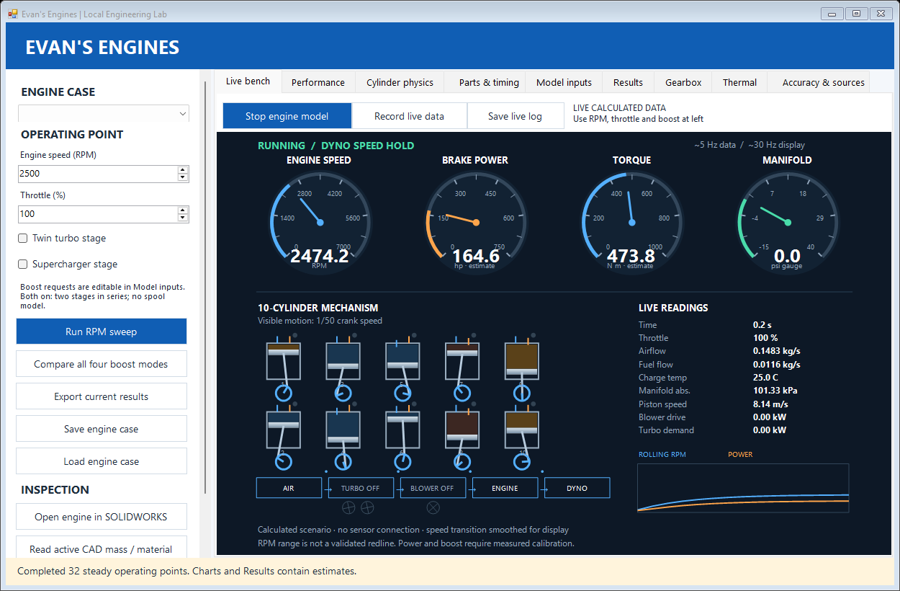

# Evan’s Engines

A local Windows engineering lab for engine scenarios, cylinder thermodynamics, parts and timing, ideal gearboxes, and simple thermal tests.



## What works

- Live RPM, horsepower, torque and manifold gauges; animated cylinders, valves and boost activity; rolling history and timestamped CSV recording with input snapshots.
- Live data is calculated by the scenario model, not ECU/sensor telemetry. Speed transitions are display smoothing; mechanism motion is shown at 1/50 speed.
- Configurable four-stroke engines with 1–16 cylinders; a 7.0 L V10 starts with geometry from the user's CAD concept.
- Direct RPM/throttle controls, sweeps, independent twin-turbo/supercharger switches and four-mode comparisons.
- Saved JSON engine cases, CSV curves and complete input snapshots.
- Cantera variable-property closed-cylinder pressure traces with prescribed heat release, energy balance and step convergence checks.
- Slow-motion piston, rod and valve inspection; optional native SOLIDWORKS part opening and read-only mass/material helper.
- Ideal six-speed gearbox calculations and independent lumped thermal warm-up tests.
- A bundled local Python runtime when built; no network needed to use the installed application.

## Build on Windows x64

Install Python 3.12 x64 and .NET Framework 4.x, then run:

```bat
build.cmd "C:\path\to\python.exe"
```

The script compiles the native UI with Windows' framework compiler, installs pinned Python dependencies locally, packages a runtime and runs numerical checks. Launch `EvansEngines.exe`. Sources are at the repository root. An optional CAD helper builds when a licensed SOLIDWORKS API interop library is present. SOLIDWORKS is not required for the other calculators.

## Accuracy

GT-POWER is a **workflow reference**, not the solver behind this project. This is an independent concept tool, not a GT-POWER replacement.

The fast engine model uses **prescribed VE/airflow and assumed efficiencies/losses**. Requested boost is assumed achieved; turbine supply and compressor maps are not solved. The cylinder model uses Cantera **air properties** with imposed Wiebe heat release; it does not predict chemical ignition, gas exchange, knock or emissions. The models have different assumptions and need not report the same horsepower. Cam timing does not automatically update the prescribed airflow. The thermal and gearbox modules are simplified, independent calculations.

Numerical PASS means consistent calculations, **not proven engine horsepower or durability**. Measured flow, burn-rate, loss, component-map and dyno data are required for calibration and validation. 7000 RPM is an initial calculation range, not a mechanically safe redline.

See [full instructions and assumptions](README.txt), [verification](Verification.md), [numerical checks](Numerical_Checks.txt), [cylinder checks](Cylinder_Checks.json), and [REA inspection](REA_Inspection.md).

## Source reuse

- [Engine Simulator](https://github.com/ange-yaghi/engine-sim): `CamProfile.cs` adapts the published MIT-licensed triangle interpolation code. The full audio/combustion solver was not ported. [License](Engine_Simulator_MIT.txt).
- [Cantera](https://github.com/Cantera/cantera): temperature-dependent gas properties. [License](Cantera_BSD.txt).
- [REA](https://github.com/morluto/rea): static artifact and CIL analysis used during development, not a physics dependency. [License](REA_MIT.txt).
- [GT-POWER](https://global.gtisoft.com/products/gt-power/): public workflow/feature reference; no proprietary code included.
- [MIT Otto-cycle notes](https://web.mit.edu/16.unified/www/SPRING/propulsion/notes/node25.html) and [NASA compressor relation](https://www.grc.nasa.gov/www/k-12/airplane/compth.html): equation references.

New application code is [MIT licensed](LICENSE). Third-party code retains its own licenses. The packaged runtime also retains Python and dependency notices.
